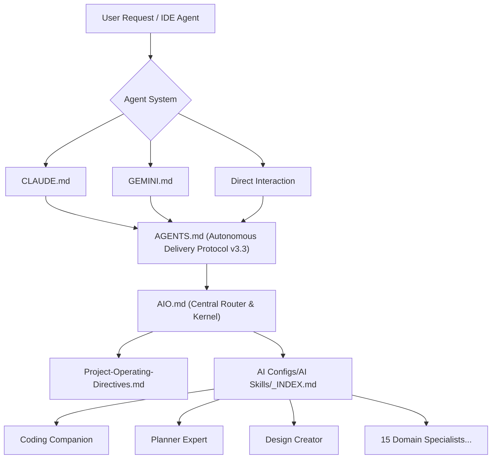

# AI Documentation Notes

> Machine-readable static analysis and module index of the **Tweaks-Configurations-Troubleshooting** repository.
> Generated per the autonomous engineering protocol defined in `AGENTS.md`. Each entry uses uniform fields:
> **Purpose · Inputs · Outputs · Dependencies · Behavior**.
> Field values are literal, descriptive, and verified against the repository structure.

---

## 0. Repository Overview

- **Type:** Non-application repository. A curated personal knowledge base and operational library of system optimizations, debloating scripts, application configuration exports, troubleshooting manuals, and an autonomous multi-model AI agent framework.
- **Primary domains:** Windows system debloating and performance tuning, Linux (Debian-based) kernel/sysctl optimization, Android (Xiaomi) ADB debloating, Termux CLI tools, browser and security application configuration profiles, network hardware tuning, and multi-model AI agent orchestration.
- **Languages / formats present:** Windows Batch (`.bat`/`.cmd`), PowerShell (`.ps1`), Windows Registry scripts (`.reg`; UTF-16 LE and ASCII), Windows Power Schemes (`.pow`), Bash command recipes (`.txt`), JSON, INI, CFG, ADG, RUPSET, CSV, JobOptions, Markdown (`.md`), HTML, and binary reference documents (`.docx`, `.pdf`, `.png`).
- **Execution model:** System modification files are executed or imported manually by the operator on target machines. Most Windows scripts include standardized self-elevation logic requiring Administrator context. AI agent instructions govern automated IDE agents.
- **Static QA summary:** All executable scripts incorporate OS-compatibility guards (Windows 10/11 version enforcement), standardized UAC self-elevation, numeric `ver`-based detection, legacy fallbacks where supported, and verified undo scripts (`Uncompact Windows.bat`, `TakeControl (Revert).reg`). Gate: **PASS**.

### 0.1 Directory Map

| Directory Path | Contents Description | Format Classes |
|---|---|---|
| [`Setups/OS Environment/Windows/Tweaks for Windows/`](Setups/OS%20Environment/Windows/Tweaks%20for%20Windows/) | Executable system debloat, service defaults, performance tuning, HMB memory allocation, power plans, and security management | `.bat`, `.cmd`, `.ps1`, `.reg`, `.pow`, `.pdf`, `.txt` |
| [`Setups/OS Environment/Windows/Troubleshooting and Tweak Guides for Windows/`](Setups/OS%20Environment/Windows/Troubleshooting%20and%20Tweak%20Guides%20for%20Windows/) | Technical guides (power plans, hardware ID driver blocking, PowerShell/CMD administration, and OS recovery) | `.pdf`, `.docx` |
| [`Setups/OS Environment/Linux/Troubleshooting and Tweak Guides for Linux (Debian Based)/`](Setups/OS%20Environment/Linux/Troubleshooting%20and%20Tweak%20Guides%20for%20Linux%20%28Debian%20Based%29/) | Debian/Ubuntu command recipes: CPU governor, `sysctl` kernel parameters, fstab swap, daemons (`preload`, `ananicy`, `nohang`), GRUB repair | `.txt` |
| [`Setups/OS Environment/Android/Tweaks for Android/`](Setups/OS%20Environment/Android/Tweaks%20for%20Android/) | Package removal inventory for Xiaomi/MIUI debloating via ADB | `.txt` |
| [`Setups/OS Environment/Android/Packages and Tools in Termux/`](Setups/OS%20Environment/Android/Packages%20and%20Tools%20in%20Termux/) | Termux setup instructions, directory relocation, and security utility setup | `.txt` |
| [`Setups/Softwares_Apps_Extensions Configurations/`](Setups/Softwares_Apps_Extensions%20Configurations/) | App configs (Process Lasso, Revo, W10Privacy, UniGetUI, Kaspersky), adblock rules, browser flags, and Xiaomi AX6000 router setup | `.json`, `.ini`, `.cfg`, `.adg`, `.rupset`, `.csv`, `.png`, `.docx`, `.pdf` |
| [`Setups/Programming Related/`](Setups/Programming%20Related/) | Developer tooling setup, configuration references, and environment troubleshooting | `.docx`, `.pdf` |
| [`AI Configs/`](AI%20Configs/) | Upstream package repository containing 15 modular agent specialists (`AI Skills/`) and canonical project templates (`Project Guidelines/`) | `.md`, `.html` |
| Root Agent Protocol & Documentation | Core orchestration engine (`AGENTS.md`, `AIO.md`, `Project-Operating-Directives.md`, `CLAUDE.md`, `GEMINI.md`, `CLI`, `README.md`, `Tech Stack Setup Guide.md`) | `.md`, `.txt` |

---

## 1. Module: Windows Executable Scripts (`Setups/OS Environment/Windows/Tweaks for Windows/`)

Executable files with direct OS side effects. Require elevated Administrator privileges and alter system registries, services, network stacks, and storage configurations.

### 1.0 Compatibility Matrix

| Script Name | Target / Min OS | Behavior on Unsupported OS | Reversible / Undo Mechanism |
|---|---|---|---|
| `Restore Windows Services To Default Settings.bat` | XP $\rightarrow$ 11 | Version-branching via `ver`: per-OS `sc config` blocks | Yes — resets service start types to Microsoft defaults |
| `Basic Protection Against to Unauthorized Access.bat` | Vista+ full; XP partial | Version-adaptive: `netsh advfirewall` on Vista+, legacy `netsh firewall` on XP; skips unsupported audit policies | Partial (Security Off / Easy Access reverses sections) |
| `Compact Windows.bat` | Windows 10 (1709+) / 11 | OS guard: cleanly exits below Windows 10 | **Yes — `Uncompact Windows.bat`** |
| `Uncompact Windows.bat` | Windows 10 (1709+) / 11 | OS guard: cleanly exits below Windows 10 | Reverses `Compact Windows.bat` |
| `Performance.bat` | Windows 10 (2004+) / 11 | OS guard: cleanly exits below Windows 10 | Partial (`Restore Windows Services…` + `TakeControl (Revert).reg`) |
| `Security On.bat` | Windows 10 (1709+) / 11 | OS guard: cleanly exits below Windows 10 | Yes — `Security Off.bat` |
| `Security Off.bat` | Vista+ / 8+ | Document-and-warn only; lowers protection | Yes — `Security On.bat` |
| `Easy Access.bat` | Vista+ / 8+ | Document-and-warn only; enables SMBv1 | Yes — `Basic Protection…bat` |
| `Force HMB to use 64 MB.ps1` | Windows 10 / 11 | Requires NVMe Host Memory Buffer support | Manual registry reset / driver default |
| `HMB Configuration Verification.ps1` | Windows 10 / 11 | Read-only verification query via PowerShell | Read-only (no state change) |
| `OfflineInsiderEnroll.cmd` | Win 10 (build $\ge 17763$)+ | Built-in build gate check; exits if unsupported | Yes — built-in menu Option 4 (Stop receiving Insider builds) |
| `TakeControl.reg` | Windows 7 $\rightarrow$ 11 | Power GUIDs apply to 10/11; inert on legacy | **Yes — `TakeControl (Revert).reg`** |
| `TakeControl (Revert).reg` | Windows 7 $\rightarrow$ 11 | Deletes TakeControl context verbs, telemetry, and hides power GUIDs | Reverses `TakeControl.reg` |
| `Registry Tweaks to Make Windows Faster.reg` | Windows 7 $\rightarrow$ 11 | Keys apply across NT 6.x / 10.x; inert where unsupported | Manual registry export restoration |
| `Enable Windows Security.reg` | Windows 10 / 11 | Registry import; inert on legacy | Yes — `Disable Windows Security.reg` |
| `Disable Windows Security.reg` | Windows 10 / 11 | Registry import; lowers security | Yes — `Enable Windows Security.reg` |
| `Enable Windows Update.reg` | Windows 7 $\rightarrow$ 11 | Deletes update disable UX policy key | Yes — `Disable Windows Update.reg` |
| `Disable Windows Update.reg` | Windows 7 $\rightarrow$ 11 | Sets `SetDisableUXWUAccess=1` | Yes — `Enable Windows Update.reg` |
| `Windows Activation.ps1` | Windows 7 $\rightarrow$ 11 | Remote code execution (`irm get.activated.win \| iex`) | Document and warn; license circumvention |
| `Internet Download Manager Activation.ps1` | Windows 7 $\rightarrow$ 11 | Remote code execution (`irm massgrave.dev/ias \| iex`) | Document and warn; license circumvention |
| `Tools of Tweaks.ps1` | Windows 10 / 11 | Remote code execution (`irm christitus.com/win \| iex`) | Document and warn |

### 1.1 Script Analysis

- **`Compact Windows.bat`**
  - **Purpose:** Compresses operating system binaries and system directories using CompactOS (`compact /CompactOS:always`) and LZX filesystem compression algorithm (`compact /c /s /a /i /exe:lzx`).
  - **Inputs:** None.
  - **Outputs:** Modified NTFS file compression states across Program Files, Program Files (x86), Windows, and local user data directories.
  - **Dependencies:** `compact.exe`, NTFS filesystem, Administrator privileges, Windows 10+.
  - **Behavior:** Standardized UAC self-elevation header $\rightarrow$ numeric `ver` OS guard $\rightarrow$ triggers CompactOS $\rightarrow$ iterates individually quoted directory array with LZX compression flags.
  - **Reversibility:** Fully reversible via `Uncompact Windows.bat`.

- **`Uncompact Windows.bat`**
  - **Purpose:** Reverses CompactOS and decompresses all system directories modified by `Compact Windows.bat`.
  - **Inputs:** None.
  - **Outputs:** Restores NTFS uncompressed state (`compact /CompactOS:never` and `compact /u /s /a /i`).
  - **Dependencies:** `compact.exe`, Administrator privileges, Windows 10+.
  - **Behavior:** UAC self-elevation $\rightarrow$ numeric `ver` guard $\rightarrow$ disables CompactOS $\rightarrow$ executes decompression iteration over directory set.

- **`Restore Windows Services To Default Settings.bat`**
  - **Purpose:** Resets startup types of all native Windows services to factory Microsoft defaults for the detected operating system version, then reboots.
  - **Inputs:** Forwarded arguments via UAC elevation relaunch.
  - **Outputs:** Mutates service configuration via `sc config <service> start= <type>`; prompts system restart.
  - **Dependencies:** `sc.exe`, `reg.exe`, `ver`, `shutdown.exe`, Administrator privileges.
  - **Behavior:** Elevates $\rightarrow$ parses exact OS version from `ver` (XP, Vista, 7, 8, 8.1, 10, 11) $\rightarrow$ jumps to OS-specific service table $\rightarrow$ reboots system.

- **`Basic Protection Against to Unauthorized Access.bat`**
  - **Purpose:** Enforces network firewall profiles, turns on logon security auditing, and disables the vulnerable SMBv1 protocol.
  - **Inputs:** None.
  - **Outputs:** Configures `netsh advfirewall`, applies `auditpol /set /subcategory`, disables SMB1 feature via DISM and registry.
  - **Dependencies:** `netsh.exe`, `auditpol.exe`, `dism.exe`, `reg.exe`, Administrator privileges.
  - **Behavior:** Self-elevates $\rightarrow$ evaluates `ver` $\rightarrow$ applies Vista+ `advfirewall` (or XP fallback) $\rightarrow$ applies auditing policies $\rightarrow$ disables SMB1.

- **`Security On.bat`**
  - **Purpose:** Enables Windows Defender hardening, LSA Protection, virtualization-based security (HVCI), imports `Enable Windows Security.reg`, and calls `Basic Protection Against to Unauthorized Access.bat`.
  - **Inputs:** None.
  - **Outputs:** System registry hardening entries and firewall/audit enforcement.
  - **Dependencies:** `reg.exe`, `regedit.exe`, Administrator privileges, Windows 10+.
  - **Behavior:** Elevates $\rightarrow$ checks Windows 10+ guard $\rightarrow$ applies registry policies $\rightarrow$ imports hardening registry pack $\rightarrow$ calls firewall script.

- **`Performance.bat`**
  - **Purpose:** Latency reduction and throughput tuning: disables device sleep states, disables DPTF, configures TCP autotuning, imports power plans (`UPC.pow`/`HPC.pow`), disables dynamic tick/synthetic timers (`bcdedit`), imports registry tweaks, and executes HMB allocation.
  - **Inputs:** None.
  - **Outputs:** CIM/WMI device power management mutations, driver state changes (`pnputil`), BCD parameters, power scheme GUID imports, and registry modifications.
  - **Dependencies:** PowerShell, `pnputil.exe`, `powercfg.exe`, `bcdedit.exe`, `reg.exe`, Administrator privileges, Windows 10 (2004+).
  - **Behavior:** Standardized elevation $\rightarrow$ OS guard $\rightarrow$ tunes power and TCP $\rightarrow$ imports power schemes $\rightarrow$ imports `TakeControl.reg` and `Registry Tweaks to Make Windows Faster.reg` $\rightarrow$ executes `Force HMB to use 64 MB.ps1`.

- **`TakeControl.reg` & `TakeControl (Revert).reg`**
  - **Purpose:** `TakeControl.reg` unlocks hidden power settings (~104 GUIDs), disables telemetry, adds "Acquire Admin Ownership" context menu verbs (`takeown` + `icacls`), and restores Windows Update automatic download policies. `TakeControl (Revert).reg` cleans up ownership context entries, re-enables telemetry defaults, and re-hides all unlocked power option GUIDs.
  - **Encoding Requirement:** **UTF-16 Little Endian with BOM**. Do not convert to UTF-8.

---

## 2. Module: Application & Extension Configurations (`Setups/Softwares_Apps_Extensions Configurations/`)

Declarative configuration exports, policy scripts, and hardware optimization settings. Contains static exports to be imported into respective applications.

| Configuration File / Subdirectory | Target Application / System | Format | Import / Usage Method |
|---|---|---|---|
| `Adguard App Settings.adg` | AdGuard Desktop Application | `.adg` (binary archive) | Settings $\rightarrow$ General Settings $\rightarrow$ Import Settings |
| `Adguard Extension Settings.json` | AdGuard Browser Extension | JSON | Extension Settings $\rightarrow$ General $\rightarrow$ Import Settings |
| `Blocked Site.csv` | Website Blocker / Firewall | CSV | Import into domain blocking or firewall rules |
| `Browsers Flags/` (`Browser Flags-1.png`, `Browser Flags-2.png`) | Chrome / Edge / Brave / Chromium | Image (`.png`) | Reference guide for flags at `chrome://flags/` (GPU rasterization, parallel downloading, smooth scrolling) |
| `Custom-Adobe Acrobat_MS Word Settings.joboptions` | Adobe Acrobat Distiller / Word PDF Export | JobOptions (XML) | Distiller $\rightarrow$ Settings $\rightarrow$ Add Adobe PDF Settings |
| `Enforce Extension on Google Chrome.txt` | Google Chrome Enterprise Policies | Registry recipe (`.txt`) | Add extension IDs to `HKLM\SOFTWARE\Policies\Google\Chrome\ExtensionInstallForcelist` |
| `Enhancer For Youtube Settings.txt` | Enhancer for YouTube Extension | Text export | Extension Options $\rightarrow$ Backup $\rightarrow$ Restore |
| `Flameshot.conf` | Flameshot Screenshot Utility | INI (`.conf`) | Replace `~/.config/flameshot/flameshot.conf` or `%APPDATA%\flameshot\flameshot.ini` |
| `Hardware Specification and Configuration.txt` | GPU Overclock & Fan Control | Reference text | Manual entry into MSI Afterburner / fan control utilities |
| `How to add Brave Search on other Browsers.txt` | Chromium / Firefox Browsers | Reference guide | Add search URL string to default search engine settings |
| `Improve Youtube Settings.json` | Improve YouTube! Extension | JSON | Extension Settings $\rightarrow$ Backup $\rightarrow$ Restore Settings |
| `Kaspersky Premium.cfg` | Kaspersky Premium Security Suite | CFG (binary) | Settings $\rightarrow$ Manage Settings $\rightarrow$ Import Settings |
| `Kaspersky Total Security.cfg` | Kaspersky Total Security | CFG (binary) | Settings $\rightarrow$ Manage Settings $\rightarrow$ Import Settings |
| `ProcessLasso Settings.INI` | Process Lasso CPU Optimization | INI | File $\rightarrow$ Import Configuration |
| `ReVancedManager_settings.json` | ReVanced Manager (Android) | JSON | Settings $\rightarrow$ Import Settings |
| `RevoUninstallerPSettings.rupset` | Revo Uninstaller Pro | RUPSET (XML) | Options $\rightarrow$ Import Settings |
| `UblockOriginConfig.txt` | uBlock Origin Extension | Text backup | Settings $\rightarrow$ Backup to file / Restore from file |
| `UblockOriginLiteConfig.json` | uBlock Origin Lite (MV3) | JSON | Settings $\rightarrow$ Import from file |
| `UniGetUI Settings.json` | UniGetUI (WingetUI) Package Manager | JSON | Settings $\rightarrow$ Backup & Restore $\rightarrow$ Load settings from file |
| `W10Privacy.ini` | W10Privacy Windows Tweaker | INI | File $\rightarrow$ Load configuration |
| `wastenotime-settings.json` | WasteNoTime Productivity Extension | JSON | Options $\rightarrow$ Import / Export Settings |
| `Xiaomi AX6000 Router Settings/` | Xiaomi AX6000 Wi-Fi 6 Router | `.docx`, `.pdf`, `.png` (1-11) | Web GUI walkthrough: WAN, LAN, DHCP, 160MHz channels, OFDMA, MU-MIMO |

---

## 3. Module: Linux Guides (`Setups/OS Environment/Linux/Troubleshooting and Tweak Guides for Linux (Debian Based)/`)

Plain-text command recipes and optimization procedures targeting Debian, Ubuntu, Linux Mint, and derivative distributions.

- **`Linux Tweaks.txt`**
  - **Purpose:** System throughput and responsiveness tuning.
  - **Mechanisms:**
    - CPU frequency governor: sets governor to `performance` via `cpupower` or `sysfs`.
    - Memory & VM tuning: configures `vm.swappiness=10`, `vm.vfs_cache_pressure=50` in `/etc/sysctl.conf`.
    - NVIDIA GPU: sets PowerMizer mode to Prefer Maximum Performance (`nvidia-settings`).
    - Swap optimization: permanent swap mount parameters in `/etc/fstab`.
    - Daemons: installs `preload` (adaptive prefetching), `ananicy` (auto-nice scheduling), and `nohang` (low-memory killer).
- **`Troubleshooting.txt`**
  - **Purpose:** System recovery and administrative workarounds.
  - **Mechanisms:** Resolves hung `snapd` services; enables GRUB multi-boot auto-detection via `os-prober`; documents `NOPASSWD: ALL` sudoers configuration (security-weakening; requires operator caution); repairs broken APT repositories.
- **`Application Installation commands in Linux.txt`**
  - **Purpose:** Command recipes for package management, Wine architecture setup (`dpkg --add-architecture i386`), Flatpak/Snap repositories, and multimedia codecs.
- **`How do you make a Bash script run automatically after login in Linux.txt`**
  - **Purpose:** Instructions for configuring user session autostart via `~/.config/autostart`, desktop environment session managers, or cron `@reboot`.

---

## 4. Module: Android & Specialized Guides

- **`Setups/OS Environment/Android/Tweaks for Android/Xiaomi.txt`**
  - **Purpose:** Curated package list for removing Xiaomi/MIUI/HyperOS analytics, bloatware, and adware via Android Debug Bridge.
  - **Command Syntax:** `adb shell pm uninstall -k --user 0 <package_name>`
  - **Target Packages:** Includes `com.miui.analytics`, `com.miui.msa.global`, `com.xiaomi.mipicks`, `com.miui.daemon`, and associated tracking daemons.
- **`Setups/OS Environment/Android/Packages and Tools in Termux/`**
  - **Purpose:** Termux environment setup, internal storage linking (`termux-setup-storage`), default path relocation, and installation recipes for network testing utilities (`Lazymux`, `Tool-X`, `Weeman`).
- **`Setups/OS Environment/Windows/Troubleshooting and Tweak Guides for Windows/`**
  - **Purpose:** Binary reference documentation:
    - `Power Option Guides.pdf`: In-depth breakdown of ACPI states, processor power management, core parking, and timer resolution.
    - `Powershell and CMD Commands.docx`: Cheatsheet of administrative recovery commands (`dism`, `sfc`, `netsh`, `chkdsk`).
    - `Stop Windows from installing drivers for specific devices.pdf`: GPO guide (`gpedit.msc`) for blocking automatic driver updates using Hardware IDs.
    - `Troubleshooting and Tweak Guides for Windows.docx` / `.pdf`: Comprehensive repair manual for networking, permissions, and system corruption.
    - `Ultimate Performance (Customized).pdf`: Instructions on unlocking GUID `e9a42b02-d5df-448d-aa00-03f14749eb61`.
- **`Setups/Programming Related/`**
  - **`Software Troubleshooting and Configurations.docx` / `.pdf`**: Troubleshooting guide for compilers, runtime path configurations, environment variables, Git operations, and IDE setups.

---

## 5. Module: Autonomous AI Multi-Model Orchestration System

The repository hosts an autonomous AI engineering protocol and specialist distribution kernel. This system allows AI assistants (Antigravity, Claude, Gemini, Codex) to operate with deterministic engineering standards.

### 5.1 Architecture & Control Files

### 5.2 Specialist Capability Catalog (`AI Configs/AI Skills/`)

| Skill / Specialist | Domain Ownership | Key Responsibilities |
|---|---|---|
| `coding-companion.md` | Application Code & Review | Repository delivery, debugging, refactoring, tests, and static verification |
| `planner-expert.md` | Planning & Architecture | Pre-implementation PRDs, milestones, task breakdown, and risk models |
| `design-creator.md` | UI / UX / Visual Systems | Interface layouts, design tokens, responsive breakpoints, and accessibility |
| `copywriting.md` | Public Copy & Voice | Channel strategy, clear communication, audience targeting, and tone |
| `email-marketing-development.md` | HTML Email Implementation | MJML, email-safe tables, Outlook VML fallbacks, and ESP compliance |
| `excel-spreadsheet-companion.md` | Spreadsheet Engineering | Formula modeling, validation, audit-friendly layouts, and financial calculations |
| `general-inquiry-research.md` | Research & Investigation | Multi-source investigation, source synthesis, and factual grounding |
| `grammar-corrector-enhancer.md` | Language Refinement | Same-language rewriting, tone consistency, and grammatical precision |
| `industry-terms-translator.md` | Terminology Mapping | Translating informal/visual descriptions into precise industry terminology |
| `language-translator.md` | Multi-Lingual Translation | EN $\leftrightarrow$ Filipino / Tagalog / Taglish translation without code distortion |
| `mathematical-inquiries.md` | Mathematics & Quantitative | Symbolic math, algorithmic proofs, complexity, and statistical modeling |
| `product-reviewer.md` | Product Quality Review | Feature audits, usability evaluations, and edge-case validation |
| `prompt-enhancer.md` | AI Prompt Engineering | Structured system prompts, few-shot examples, and boundary conditions |
| `spoon-feed-reviewer.md` | Progressive Learning | Step-by-step explanatory breakdowns for complex concepts |
| `tech-companion.md` | Technical Guidance | System administration, toolchain configuration, and operational diagnostics |

### 5.3 Operating Directives & Canonical Templates

- **`AGENTS.md`:** Protocol revision 2.8.0 / version 3.3. Establishes the autonomous delivery workflow, domain lenses, anti-slop guidelines, bounded revision (reassess after 3 failed theories), mandatory GitHub secret protection, and handover contracts.
- **`AIO.md`:** Embedded Personal Style contract (BLUF, plain language, active voice, progressive disclosure), algorithmic efficiency, and RAG retrieval practices.
- **`AI Configs/Project Guidelines/`:** Canonical templates (`Plan and Goals.md`, `Design Prototype.md`, `Database Structure.md`, `Backend Functionalities.md`, `Architecture and Operations.md`, `Verification and Evaluation.md`, `Decisions and Handover.md`, `AI Documentation Notes.md`, `Tech Stack Setup Guide.md`, `tech-stack-setup.html`).

---

## 6. Systemic Operational Mechanics

- **Architecture:** Categorized document and configuration store. Zero runtime dependencies between modules, except explicit Windows script invocation chains (`Performance.bat` and `Security On.bat`).
- **Call Chains (Windows):**
  - `Performance.bat` $\rightarrow$ imports `Registry Tweaks to Make Windows Faster.reg` $\rightarrow$ imports `TakeControl.reg` $\rightarrow$ imports `UPC.pow` / `HPC.pow` $\rightarrow$ invokes `Force HMB to use 64 MB.ps1`.
  - `Security On.bat` $\rightarrow$ calls `Basic Protection Against to Unauthorized Access.bat` $\rightarrow$ imports `Enable Windows Security.reg`.
  - `Security Off.bat` $\rightarrow$ calls `Easy Access.bat` $\rightarrow$ imports `Disable Windows Security.reg`.
- **Data Flow:** Strictly unidirectional and operator-mediated: File $\rightarrow$ (manual operator execution / import) $\rightarrow$ OS / Application state. No telemetry returns to the repository.
- **Privilege Boundaries:**
  - Windows scripts: Elevated Administrator (enforced by UAC self-elevation).
  - Linux scripts: Root (`sudo`).
  - Android tweaks: ADB shell under User 0 (`pm uninstall -k --user 0`).
  - Configurations: User-level application import.
- **Idempotency & Reversibility:** Registry files and `sc config` commands are idempotent. Reversible actions feature dedicated counterpart scripts (`Compact Windows.bat` $\leftrightarrow$ `Uncompact Windows.bat`; `TakeControl.reg` $\leftrightarrow$ `TakeControl (Revert).reg`; `Security On.bat` $\leftrightarrow$ `Security Off.bat`; `Enable Windows Update.reg` $\leftrightarrow$ `Disable Windows Update.reg`).

---

## 7. QA & Risk Findings

| ID | File / Component | Severity | Finding & Operational Mitigation | Status |
|---|---|---|---|---|
| Q1 | `Restore Windows Services…bat` | Defect | Malformed parameter handling previously dropped arguments during UAC elevation. | Fixed & Verified |
| Q2 | `Restore Windows Services…bat` | Defect | Missing `start` keyword in `AssignedAccessManagerSvc` configuration block. | Fixed & Verified |
| Q8 | `TakeControl.reg` (line 24) | Defect | Truncated `IsolatedCommand` string caused unterminated quotation error bleeding into subsequent `WindowsUpdate\AU` keys. Restored full command string. | Fixed & Verified |
| Q9 | `Compact Windows.bat` | Defect | Outer quotes stripped inner quotes during directory iteration, causing `(x86)` parenthesis to break the `for` loop and silently aborting per-directory compression. Corrected array definition. | Fixed & Verified |
| Q10 | `Restore Windows Services…bat` | Defect | Substring match tested `Windows 8` before `Windows 8.1`, causing 8.1 to take the wrong branch. Replaced with robust numeric `ver` parsing across XP through 11. | Fixed & Verified |
| Q11 | `Security On.bat` / `.reg` | Advisory | Defender Tamper Protection may reject or revert registry modifications to security services. Inline notes instruct operator to toggle in Windows Security GUI if registry keys do not persist. | Mitigated by Documentation |
| Q12 | Activation & Titus scripts | Security / Licensing | `irm ... \| iex` downloads and executes remote code as Administrator. Activation scripts circumvent licensing. Files left unmodified; explicit security warnings added to documentation. | Document & Warn |
| Q5 | `TakeControl.reg` | Risk | Broad modifications to system power GUIDs and shell verbs. Mitigated by the creation of `TakeControl (Revert).reg`. | Mitigated by Undo Script |
| Q7 | `.reg` files | Integrity | `TakeControl.reg`, `TakeControl (Revert).reg`, and Windows Update `.reg` files require UTF-16 LE with BOM encoding. Converting to UTF-8 causes `reg import` failures. | Guarded by Protocol |

---

## 8. Maintenance Protocol for Future AI Agents

1. **Scope of Executable Code:** Executable logic resides primarily in `Setups/OS Environment/Windows/Tweaks for Windows/`. Focus deep static and dynamic testing on this directory when changes occur.
2. **Encoding Discipline:**
   - Registry files (`TakeControl.reg`, `TakeControl (Revert).reg`, `Enable/Disable Windows Update.reg`) must strictly retain **UTF-16 LE with BOM**.
   - Batch scripts must be saved in **ASCII or UTF-8 without BOM** with **CRLF** line endings.
   - Shell scripts and text guides must use **UTF-8 with LF** line endings.
3. **Compatibility Safeguards:**
   - Any script targeting Windows 10/11 features must incorporate the standard numeric `ver` detection block and exit cleanly on unsupported versions.
   - Never remove rollback / undo scripts (`Uncompact Windows.bat`, `TakeControl (Revert).reg`).
4. **Documentation Sync:** When modifying scripts or adding configurations, update:
   - `README.md` (directory map, security disclosures, and navigation).
   - `AI Documentation Notes.md` (uniform fields: Purpose, Inputs, Outputs, Dependencies, Behavior, compatibility matrix).
   - `Tech Stack Setup Guide.md` (operator execution workflows, prerequisites, and diagnostics).
