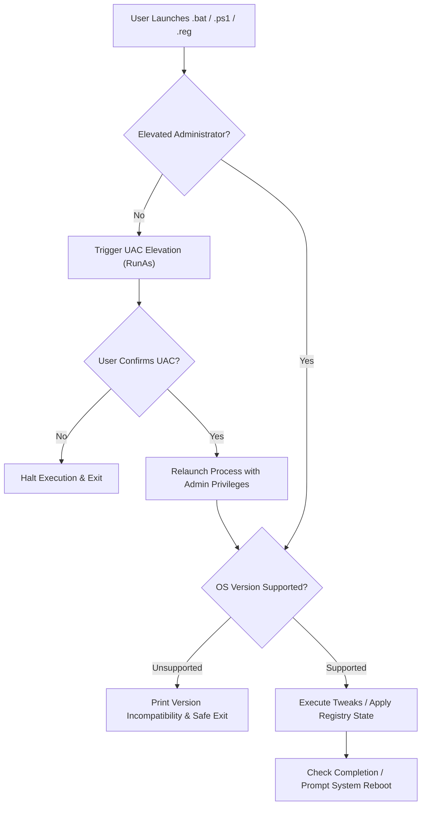
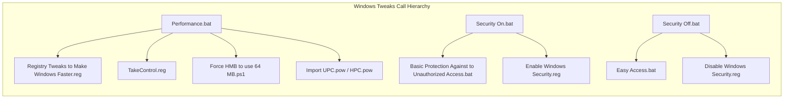

# Tweaks-Configurations-Troubleshooting

A curated knowledge base and operational repository containing customized operating system optimizations (Windows, Linux, Android/Termux), application and extension configuration exports, hardware and router tuning walkthroughs, troubleshooting manuals, and an autonomous multi-model AI agent engineering framework.

> **Use at your own risk.** Many scripts and registry modifications directly alter operating system kernels, services, security boundaries, and filesystem states. Always back up system registries, export configurations, and create restore points prior to applying modifications.

---

## Repository Overview

```
Tweaks-Configurations-Troubleshooting/
├── AI Configs/                                    # Upstream AI agent distribution package
│   ├── AI Skills/                                 # 15 modular AI specialist capabilities
│   └── Project Guidelines/                        # Canonical project documentation templates
├── Setups/                                        # Core system tweaks and configurations
│   ├── OS Environment/
│   │   ├── Android/                               # Xiaomi ADB debloat lists & Termux tooling
│   │   ├── Linux/                                 # Debian-based performance & troubleshooting guides
│   │   └── Windows/                               # Windows batch scripts, registry tweaks, and guides
│   ├── Programming Related/                       # Developer tool troubleshooting & setups
│   └── Softwares_Apps_Extensions Configurations/  # App profiles, adblock rules, browser flags, router setup
├── AGENTS.md                                      # Autonomous engineering & delivery protocol (v3.3)
├── AI Documentation Notes.md                      # Machine-readable static analysis & module index
├── AIO.md                                         # All-In-One router, skills index & operating kernel
├── CLAUDE.md                                      # Anthropic Claude agent redirection entrypoint
├── CLI                                            # Quick-reference terminal cheatsheet
├── GEMINI.md                                      # Google Gemini agent redirection entrypoint
├── LICENSE                                        # MIT License
├── Project-Operating-Directives.md                # Shared agent runtime & operational directives
├── README.md                                      # Project overview & navigation portal
└── Tech Stack Setup Guide.md                      # Onboarding, execution workflows & diagnostics
```

---

## Directory Navigation

| Module Directory | Primary Contents | Formats | Elevation / Privileges |
|---|---|---|---|
| [`Setups/OS Environment/Windows/Tweaks for Windows/`](Setups/OS%20Environment/Windows/Tweaks%20for%20Windows/) | System debloating, service management, performance tuning, HMB allocation, power plans, and security controls | `.bat`, `.cmd`, `.ps1`, `.reg`, `.pow`, `.pdf` | Administrator (UAC self-elevating) |
| [`Setups/OS Environment/Windows/Troubleshooting and Tweak Guides for Windows/`](Setups/OS%20Environment/Windows/Troubleshooting%20and%20Tweak%20Guides%20for%20Windows/) | Diagnostic manuals, power options, hardware ID driver blocking, and PowerShell/CMD commands | `.pdf`, `.docx` | Reference only |
| [`Setups/OS Environment/Linux/Troubleshooting and Tweak Guides for Linux (Debian Based)/`](Setups/OS%20Environment/Linux/Troubleshooting%20and%20Tweak%20Guides%20for%20Linux%20%28Debian%20Based%29/) | CPU governor configuration, kernel `sysctl` tuning, swap management, daemon installations (`preload`, `ananicy`, `nohang`), and GRUB repair | `.txt` | Root (`sudo`) |
| [`Setups/OS Environment/Android/`](Setups/OS%20Environment/Android/) | Xiaomi/MIUI package debloat list via ADB, and Termux framework installation procedures | `.txt` | ADB User 0 / Termux CLI |
| [`Setups/Softwares_Apps_Extensions Configurations/`](Setups/Softwares_Apps_Extensions%20Configurations/) | Browser extensions, system tools (Process Lasso, Revo, W10Privacy, UniGetUI), adblock filters, browser flags, and Xiaomi AX6000 Wi-Fi 6 router setup | `.json`, `.ini`, `.cfg`, `.adg`, `.rupset`, `.csv`, `.png`, `.docx`, `.pdf` | User / App Import |
| [`Setups/Programming Related/`](Setups/Programming%20Related/) | Developer environment, toolchain troubleshooting, and runtime setup reference guide | `.docx`, `.pdf` | Reference only |
| [`AI Configs/`](AI%20Configs/) | Upstream package repository containing 15 specialized agent personas ([`AI Skills/`](AI%20Configs/AI%20Skills/)) and canonical guidelines ([`Project Guidelines/`](AI%20Configs/Project%20Guidelines/)) | `.md`, `.html` | AI Agent Framework |
| Root Agent Protocol | Core multi-model orchestration contracts ([`AGENTS.md`](AGENTS.md), [`AIO.md`](AIO.md), [`Project-Operating-Directives.md`](Project-Operating-Directives.md), [`CLAUDE.md`](CLAUDE.md), [`GEMINI.md`](GEMINI.md)) | `.md` | AI Agent Framework |

---

## Security, Safety & Risk Disclosures

Read this section before running any scripts or importing registry profiles:

### 1. Windows Operating System Compatibility
Most scripts in `Setups/OS Environment/Windows/Tweaks for Windows/` target **Windows 10 (version 1709+) and Windows 11**.
- **Automated Version Guards:** First-party scripts incorporate numeric `ver`-based guards. Scripts requiring Windows 10/11 will exit cleanly on older versions (e.g., Windows 7, 8, 8.1) rather than executing incompatible commands.
- **Adaptive Fallbacks:** Select utility scripts (such as `Restore Windows Services To Default Settings.bat` and `Basic Protection Against to Unauthorized Access.bat`) dynamically detect legacy platforms and branch into OS-specific syntax (`netsh firewall`, `auditpol` bypasses, registry-based SMBv1 controls).

### 2. Registry Backup & Encoding Integrity
- **Mandatory Backup:** Before importing any `.reg` file, export the targeted registry hives (`reg export`) or establish a System Restore Point.
- **UTF-16 LE with BOM Encoding:** Critical registry files—including `TakeControl.reg`, `TakeControl (Revert).reg`, and Windows Update toggles—are encoded in **UTF-16 Little Endian with BOM**. Modifying or saving these files as UTF-8 will cause `reg import` and Windows Registry Editor to fail.
- **Dedicated Undo Scripts:**
  - `Compact Windows.bat` $\rightarrow$ Reversible via `Uncompact Windows.bat`.
  - `TakeControl.reg` $\rightarrow$ Reversible via `TakeControl (Revert).reg`.
  - `Disable Windows Update.reg` $\rightarrow$ Reversible via `Enable Windows Update.reg`.
  - `Security Off.bat` $\rightarrow$ Reversible via `Security On.bat`.

### 3. Deliberately Weakened Security Profiles
- **`Security Off.bat`**, **`Easy Access.bat`**, and **`Disable Windows Security.reg`** **intentionally lower system defenses**. They disable Microsoft Defender features, turn off logon audit trails, and re-enable the deprecated **SMBv1** protocol.
- **Policy:** Apply these solely for isolated, temporary troubleshooting in non-hostile environments. Never deploy on internet-facing systems, and immediately re-arm protection using `Security On.bat` once testing concludes.

### 4. Remote Code Execution One-Liners
- `Windows Activation.ps1`, `Internet Download Manager Activation.ps1`, and `Tools of Tweaks.ps1` execute scripts fetched directly from remote repositories via PowerShell (`irm ... | iex`) with elevated administrative privileges.
- Always inspect upstream scripts prior to invocation. Note that activation utilities are license-circumvention tools; verify compliance with your licensing policies before use.

---

## System Workflows

### Windows Script Execution Flow



### Module Call Architecture



---

## Detailed Documentation Links

- **Technical Analysis & Compatibility Matrix:** Refer to [`AI Documentation Notes.md`](AI%20Documentation%20Notes.md) for full static analysis, detailed per-script inputs/outputs, QA findings, defect repairs, and risk ratings.
- **Execution & Setup Walkthrough:** Refer to [`Tech Stack Setup Guide.md`](Tech%20Stack%20Setup%20Guide.md) for step-by-step instructions on setting execution policies, applying batch/PowerShell/registry files, using ADB on Android, executing Linux sysctl commands, and importing software configuration profiles.
- **Autonomous Agent Protocol:** Refer to [`AGENTS.md`](AGENTS.md) and [`AIO.md`](AIO.md) for directives governing AI agent delivery, domain lenses, and multi-specialist coordination.
- **CLI Cheatsheet:** Refer to [`CLI`](CLI) for command-line file manipulation and navigation quick references.

---

## License

This repository is distributed under the terms of the [MIT License](LICENSE). Third-party scripts and utilities retain their respective author licenses and attributions.
