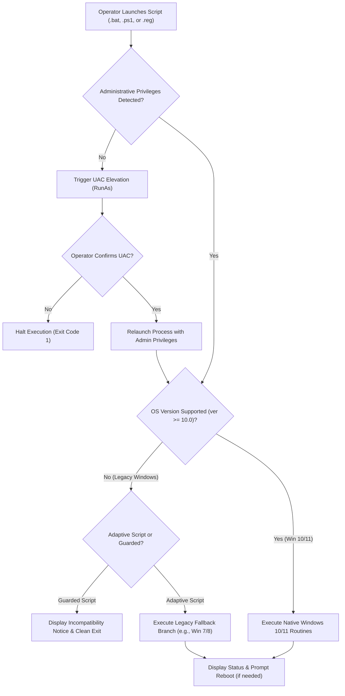
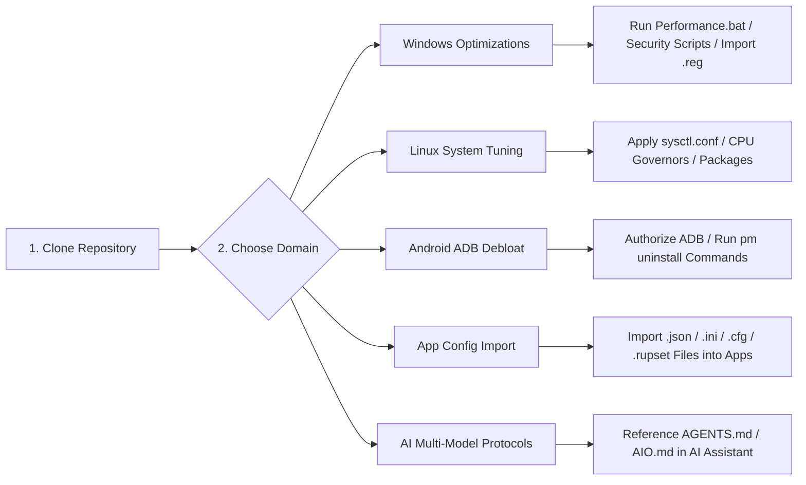

# Tech Stack Setup Guide

A reproducible onboarding and operational guide for executing the scripts, importing configuration profiles, applying registry tweaks, and configuring the system environments contained in the **Tweaks-Configurations-Troubleshooting** repository.

---

## 1. System Orientation & Tech Stack Reference

This repository is a curated operational library of system optimizations, configuration exports, and multi-model AI agent directives. The runtime environment spans native operating system utilities, shell runtimes, declarative formats, and AI agent frameworks.

### Prerequisite & Utility Matrix

| Platform / Tool | Plain-Language Purpose | Supported / Tested Range | Official Install / Source | Verification Command |
|---|---|---|---|---|
| **Windows PowerShell** | Script execution and HMB configuration | PowerShell 5.1+ / PowerShell 7+ | Built into Windows 10/11 | `powershell -Command "$PSVersionTable.PSVersion"` |
| **Windows Command Prompt** | Execution of batch scripts (`.bat`, `.cmd`) | Windows 10 (1709+) / Windows 11 | Built into Windows | `cmd.exe /c ver` |
| **Windows Registry Editor** | Merging `.reg` configuration profiles | Windows NT 6.1 (Win 7) $\rightarrow$ 10.0 (Win 11) | Built into Windows (`reg.exe`) | `reg.exe query "HKLM\Software" /ve` |
| **Linux Bash Shell** | Executing terminal recipes and system tweaks | Bash 4.4+ / Debian, Ubuntu, Mint | Debian base package | `bash --version` |
| **Linux Kernel Utilities** | Modifying kernel parameters & daemons | Linux kernel 5.4+ (`sysctl`, `systemctl`) | Built into system distributions | `sysctl --version` |
| **Android Platform Tools** | Executing debloat commands via ADB | ADB version 1.0.41+ | [Android Developer Tools](https://developer.android.com/tools/releases/platform-tools) | `adb version` |
| **Termux** | Local terminal environment on Android | Android 7.0+ (F-Droid release) | [Termux on F-Droid](https://f-droid.org/packages/com.termux/) | `pkg --version` |
| **AI Agent IDE** | Executing autonomous protocols | Antigravity, Claude Code, Gemini CLI, Cursor | Respective official distributions | Check IDE agent status |

---

## 2. Setup Workflows at a Glance

### Script Execution & Security Architecture



### Repository Configuration Lifecycle



---

## 3. Step-by-Step Operator Walkthrough

### Step 1: Obtain the Repository

Clone the repository locally or extract the archive to a local path (avoid network shares where elevation tokens do not propagate):

```bash
git clone https://github.com/SecretlySpy/Tweaks-Configurations-Troubleshooting.git
cd Tweaks-Configurations-Troubleshooting
```

---

### Step 2: Configure System Environment & Execution Policies

#### Windows
1. Open PowerShell as Administrator.
2. Enable execution of signed local scripts by updating the execution policy:
   ```powershell
   Set-ExecutionPolicy RemoteSigned -Scope CurrentUser -Force
   ```
3. Create a System Restore Point or export target registry keys before applying any modification:
   ```powershell
   Checkpoint-Computer -Description "Pre-Tweaks Baseline" -RestorePointType "MODIFY_SETTINGS"
   ```

#### Linux
Ensure your user account has `sudo` privileges and package manager databases are refreshed:
```bash
sudo apt update
```

#### Android
1. On your device, open **Settings** $\rightarrow$ **About Phone** $\rightarrow$ Tap **Build Number** 7 times to enable Developer Options.
2. Open **Developer Options** $\rightarrow$ Enable **USB Debugging** (and **USB Debugging (Security settings)** on MIUI/HyperOS).
3. Connect the phone via USB and authorize the computer when prompted.
4. Verify the connection:
   ```bash
   adb devices
   ```
   *Expected result:* The device serial appears with the status `device` (not `unauthorized`).

---

### Step 3: Executing Windows Tweaks & Optimizations

All Windows executable scripts are located in:
[`Setups/OS Environment/Windows/Tweaks for Windows/`](Setups/OS%20Environment/Windows/Tweaks%20for%20Windows/)

#### A. Comprehensive Performance Tuning (`Performance.bat`)
- **What it does:** Configures device sleep policies, disables DPTF, adjusts TCP chimney and autotuning, imports power schemes, optimizes BCD timers, merges registry speed tweaks, imports power settings GUIDs, and executes HMB allocation.
- **Execution:**
  Right-click `Performance.bat` $\rightarrow$ select **Run as administrator** (or double-click; the script will prompt for UAC elevation).
- **Power Schemes:** The folder contains pre-configured power plan exports (`UPC.pow` and `HPC.pow`). You can also import them manually:
  ```cmd
  powercfg -import "Setups\OS Environment\Windows\Tweaks for Windows\UPC.pow"
  ```
- **HMB Verification:** To verify Host Memory Buffer status on NVMe SSDs, run:
  ```powershell
  powershell -ExecutionPolicy Bypass -File "Setups\OS Environment\Windows\Tweaks for Windows\HMB Configuration Verification.ps1"
  ```

#### B. Storage Footprint Compression (`Compact Windows.bat`)
- **What it does:** Applies Windows CompactOS compression and compresses key application folders using the NTFS LZX compression algorithm.
- **Execution:** Run `Compact Windows.bat` as Administrator.
- **Safe Rollback:** If you need to decompress your system back to the default state, run `Uncompact Windows.bat`.

#### C. System Ownership & Power GUIDs (`TakeControl.reg`)
- **What it does:** Unlocks hidden Windows power settings, disables telemetry policies, and registers the "Acquire Admin Ownership" context menu.
- **Execution:** Double-click `TakeControl.reg` and confirm the UAC and Registry Editor prompts.
- **Important:** Ensure the file remains encoded in **UTF-16 LE with BOM**.
- **Safe Rollback:** To restore default ownership context menus and re-hide power GUIDs, double-click `TakeControl (Revert).reg`.

#### D. Security Hardening vs. Troubleshooting Profiles
- **Hardening (`Security On.bat`):** Enables Defender, enforces firewall profiles, enables auditing, and disables SMBv1.
- **Troubleshooting (`Security Off.bat`):** Deliberately lowers Defender shields, turns off auditing, and enables legacy SMBv1 for isolated diagnostics. Re-run `Security On.bat` immediately after testing.

#### E. Service Configuration Restoration (`Restore Windows Services To Default Settings.bat`)
- **What it does:** Automatically parses your exact Windows version using `ver` (XP through 11) and restores all service startup states to Microsoft defaults.
- **Execution:** Run as Administrator. The system will prompt to restart upon completion.

---

### Step 4: Applying Linux Optimizations

All Linux reference guides are located in:
[`Setups/OS Environment/Linux/Troubleshooting and Tweak Guides for Linux (Debian Based)/`](Setups/OS%20Environment/Linux/Troubleshooting%20and%20Tweak%20Guides%20for%20Linux%20%28Debian%20Based%29/)

1. **CPU Governor Optimization:**
   Set the active CPU frequency governor to maximum performance:
   ```bash
   echo performance | sudo tee /sys/devices/system/cpu/cpu*/cpufreq/scaling_governor
   ```
2. **Virtual Memory & Cache Tuning:**
   Append optimized parameters to `/etc/sysctl.conf`:
   ```bash
   sudo bash -c 'cat << EOF >> /etc/sysctl.conf
   vm.swappiness=10
   vm.vfs_cache_pressure=50
   EOF'
   sudo sysctl -p
   ```
3. **Background Daemon Installation:**
   Install prefetching and task-scheduling daemons:
   ```bash
   sudo apt install preload
   ```

---

### Step 5: Android ADB Debloating & Termux Tooling

Guides and package lists are located in:
[`Setups/OS Environment/Android/`](Setups/OS%20Environment/Android/)

#### A. Xiaomi / HyperOS ADB Package Debloat
1. Open [`Setups/OS Environment/Android/Tweaks for Android/Xiaomi.txt`](Setups/OS%20Environment/Android/Tweaks%20for%20Android/Xiaomi.txt).
2. Connect your device via ADB and execute the uninstallation commands for selected packages:
   ```bash
   adb shell pm uninstall -k --user 0 com.miui.analytics
   adb shell pm uninstall -k --user 0 com.miui.msa.global
   adb shell pm uninstall -k --user 0 com.xiaomi.mipicks
   ```
3. *Note:* The `-k` flag preserves application cache, allowing reinstallation via `adb shell cmd package install-existing <package_name>` if needed.

#### B. Termux Setup
1. Launch Termux on Android.
2. Grant internal storage permissions:
   ```bash
   termux-setup-storage
   ```
3. Update package mirrors and packages:
   ```bash
   pkg update && pkg upgrade -y
   ```
4. Consult [`Setups/OS Environment/Android/Packages and Tools in Termux/`](Setups/OS%20Environment/Android/Packages%20and%20Tools%20in%20Termux/) for tool recipes.

---

### Step 6: Importing Application & Extension Profiles

All application profiles are located in:
[`Setups/Softwares_Apps_Extensions Configurations/`](Setups/Softwares_Apps_Extensions%20Configurations/)

| Target Tool | Configuration Source | Step-by-Step Import Action |
|---|---|---|
| **AdGuard Desktop** | `Adguard App Settings.adg` | Open AdGuard $\rightarrow$ Settings $\rightarrow$ General Settings $\rightarrow$ Import Settings |
| **AdGuard Extension** | `Adguard Extension Settings.json` | Extension Options $\rightarrow$ General $\rightarrow$ Import Settings |
| **uBlock Origin** | `UblockOriginConfig.txt` | Dashboard $\rightarrow$ Settings tab $\rightarrow$ Restore from file |
| **uBlock Origin Lite** | `UblockOriginLiteConfig.json` | Extension Dashboard $\rightarrow$ Settings $\rightarrow$ Import from file |
| **Process Lasso** | `ProcessLasso Settings.INI` | File $\rightarrow$ Import Configuration $\rightarrow$ Select file |
| **Revo Uninstaller Pro** | `RevoUninstallerPSettings.rupset` | Options $\rightarrow$ General $\rightarrow$ Import Settings |
| **UniGetUI (WingetUI)** | `UniGetUI Settings.json` | Settings $\rightarrow$ Backup & Restore $\rightarrow$ Load settings from file |
| **W10Privacy** | `W10Privacy.ini` | File $\rightarrow$ Load configuration |
| **Flameshot** | `Flameshot.conf` | Place in `~/.config/flameshot/flameshot.conf` (Linux) or `%APPDATA%\flameshot\flameshot.ini` (Windows) |
| **Improve YouTube!** | `Improve Youtube Settings.json` | Extension Settings $\rightarrow$ Backup $\rightarrow$ Restore Settings |
| **WasteNoTime** | `wastenotime-settings.json` | Extension Options $\rightarrow$ Import / Export Settings |
| **Xiaomi AX6000 Router** | `Xiaomi AX6000 Router Settings/` | Follow walkthrough screenshots (`1.png` - `11.png`) and documentation |

---

### Step 7: Multi-Model AI Agent Activation

This repository contains multi-model orchestration protocols designed for autonomous IDE agents.
- **For Google Antigravity / Gemini:** The workspace automatically parses [`GEMINI.md`](GEMINI.md) and loads the autonomous engineering protocol in [`AGENTS.md`](AGENTS.md).
- **For Anthropic Claude Code:** The workspace automatically parses [`CLAUDE.md`](CLAUDE.md) which routes execution into [`AGENTS.md`](AGENTS.md).
- **For Human Operators:** When working with an AI assistant in this repository, you can instruct it:
  > *"Follow the autonomous engineering protocol in AGENTS.md and AIO.md for all tasks."*

---

## 4. File Type Handling & Risk Tier Matrix

| File Type / Extension | Classification | Execution Technique | Operating Risk Tier | Reversibility |
|---|---|---|---|---|
| **`.bat` / `.cmd`** | Windows Batch Script | Elevated Shell Execution | **Major** (System Services & Kernel Parameters) | Reversible if counterpart undo script exists |
| **`.ps1`** | PowerShell Script | Elevated PowerShell Session | **Major** (Driver & Hardware State) | Script-specific |
| **`.reg` (UTF-16 LE)** | Windows Registry Patch | Double-click or `reg.exe import` | **Major** (HKLM/HKCU Policies) | Reversible via Revert `.reg` or hive export |
| **`.pow`** | Power Scheme Archive | `powercfg -import` | **Minor** (Power Profile Management) | Delete imported scheme via `powercfg -delete` |
| **`.json` / `.ini` / `.cfg`** | App Configuration | User-driven application import | **Minor** (Application-scoped settings) | Reversible via application default reset |
| **`.txt`** | Text Command Recipes | Manual operator copy-paste | **Minor** to **Major** (depending on command) | Manual command-level reversal |
| **`.md`** | AI Protocols & Documentation | Read by agents and operators | **None** (Static Documentation) | Git version control |

---

## 5. Failure Diagnostics, Troubleshooting & Safe Reset

### 1. UAC Elevation Loop on Batch Scripts
- **Symptom:** The script prompts for Administrator privileges repeatedly, then closes without applying changes.
- **Cause:** The repository is situated on a network path (UNC), mapped network drive, or directory with restrictive inheritance. Windows elevation drops network context.
- **Fix:** Move or clone the repository to a physical, local drive (e.g., `C:\Tweaks-Configurations-Troubleshooting`).

### 2. PowerShell Script Execution Disabled
- **Symptom:** `File ... cannot be loaded because running scripts is disabled on this system`.
- **Cause:** Windows client default execution policy restricts script execution.
- **Fix:** Run `Set-ExecutionPolicy RemoteSigned -Scope CurrentUser -Force` in an elevated PowerShell session.

### 3. Registry File Import Failure or Invalid File Format
- **Symptom:** Registry Editor displays error: *The specified file is not a registry script. You can only import binary registry files.*
- **Cause:** The `.reg` file was saved in UTF-8 or without Byte Order Mark (BOM).
- **Fix:** Ensure `TakeControl.reg`, `TakeControl (Revert).reg`, and Windows Update `.reg` files are saved strictly in **UTF-16 LE with BOM**. In PowerShell:
  ```powershell
  $content = Get-Content -Path "TakeControl.reg" -Raw
  [System.IO.File]::WriteAllText("$pwd\TakeControl.reg", $content, [System.Text.Encoding]::Unicode)
  ```

### 4. Defender Tamper Protection Reverting Registry Tweaks
- **Symptom:** Registry keys under `HKLM\SOFTWARE\Microsoft\Windows Defender` do not persist after reboot.
- **Cause:** Microsoft Defender Tamper Protection blocks external modifications to security settings.
- **Fix:** Open **Windows Security** $\rightarrow$ **Virus & threat protection** $\rightarrow$ **Manage settings** $\rightarrow$ Toggle **Tamper Protection** to Off before running security configuration scripts, then re-enable once desired state is verified.

### 5. ADB Device Unauthorized or Offline
- **Symptom:** `adb devices` shows the device as `unauthorized`.
- **Cause:** The USB debugging RSA key prompt was missed or declined on the phone.
- **Fix:** Unplug the USB cable, run `adb kill-server && adb start-server`, reconnect the phone, and tap **Always allow from this computer** on the dialog.

### 6. Emergency System Recovery
- If an applied registry patch or batch modification causes system instability:
  1. Boot into Windows Recovery Environment (Hold `Shift` while clicking **Restart**).
  2. Select **Troubleshoot** $\rightarrow$ **Advanced options** $\rightarrow$ **System Restore**.
  3. Select the restore point created prior to applying tweaks.
  4. Alternatively, open Command Prompt in WinRE and import `TakeControl (Revert).reg` or run `Uncompact Windows.bat`.
