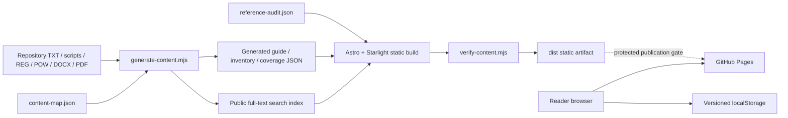

# Technical Resources architecture and operations

## System context

Technical Resources is a build-time migration and static-reading system. There is no application server, database, account service, or command-execution service.

## Ownership and trust boundaries

| Boundary | Trusted input | Untrusted or review-required input | Control |
| --- | --- | --- | --- |
| Source discovery | Repository paths under the approved roots | File contents, binary extraction, third-party URLs, configuration exports | Allow-listed roots, hashes, explicit guide map, extraction status |
| Content generation | Canonical IDs, slugs, placements, status | HTML/script-like text inside sources | Render source text as escaped text; no raw HTML insertion |
| Publication status | `published`, `review-only`, `blocked` | Operational instructions with safety/licensing concerns | Withhold source text for non-published statuses; test the boundary |
| Public artifact | Astro-generated HTML/assets/search JSON | Executable/registry/power-plan source formats | Artifact extension rejection and exact `dist` review |
| Browser state | Schema version and guide ID | Corrupt JSON, denied reads/writes, quota errors | Normalize on read, fail closed to empty state, keep reading available |
| Deployment | Successful build artifact | Staged/outgoing sensitive content and external GitHub state | Separate review, Pages environment, least-privilege OIDC permissions |

Retrieved source text is evidence, not an instruction to the generator or browser. The pipeline does not evaluate commands or treat source prose as model/tool authority.

## Build-time data flow

1. `content-map.json` defines 25 canonical guides, routes, placements, compatibility, risk, publication status, and source paths.
2. `scripts/generate-content.mjs` inventories 79 files, hashes each source, records Git revision when tracked, and extracts supported text.
3. PDF and DOCX sources use `pdfjs-dist` and `mammoth`; binary extraction remains subject to manual fidelity review.
4. The generator emits `src/data/guides.generated.json`, `source-inventory.generated.json`, `coverage.generated.json`, and `public/data/search-index.json`.
5. Astro statically renders overview, collection, category, directory, saved, article, Starlight documentation, and 404 routes.
6. Starlight generates Pagefind data from built pages; the custom directory search loads its JSON index only when needed.
7. `reference-audit.json` records one bounded reference disposition per canonical guide; supplementary first-party/standards-owner links render beside source-authored links.
8. `scripts/verify-content.mjs`, `verify-reference-audit.mjs`, and `verify-built-artifact.mjs` check identities, 100% primary mapping, hashes, publication boundaries, reference coverage, local links/assets, malformed URLs, prohibited public file types, and high-confidence credential signatures without printing values.

Generated files should be regenerated from source/map changes, not edited by hand.

## Routing and deployment

- Canonical site: `https://secretlyspy.github.io`.
- Repository base path: `/Tweaks-Configurations-Troubleshooting`.
- Static routes use trailing slashes.
- `withBase()` prefixes custom links with `import.meta.env.BASE_URL`.
- `.github/workflows/technical-resources-pages.yml` is the single project workflow. It uses `actions/checkout@v7`, Node 24 with locked npm dependencies, project-local Chromium, `npm test`, `actions/upload-pages-artifact@v5` with hidden files enabled for `.nojekyll`, and `actions/deploy-pages@v5`.
- The workflow uploads only the verified `knowledge-base/dist` tree and requires `dist/.nojekyll`; the former Jekyll and whole-repository static upload workflows were removed because they were incompatible with Astro and the public-artifact boundary.
- GitHub Pages must use **Settings → Pages → Build and deployment → Source: GitHub Actions**. The local workflow is not proof that this setting, the remote run, or deployment is current; those external states remain **UNVERIFIED**.

The initial local Playwright attempt on 2026-11-19 exposed a test-harness/base-path 404: leading-slash test routes escaped the repository subpath. The harness uses a trailing-slash base URL plus relative routes. On 2026-11-20 the suite expanded to 27 cases for the Figma-aligned collection and tablet shell; the final matrix passed at desktop, tablet, and mobile widths after repairing bookmark visibility and scrollable-code-region accessibility. The public Pages deployment remains unverified until observed.

## Runtime behavior

Most runtime functionality is static HTML and CSS. Small client scripts provide:

- Responsive drawer behavior.
- On-demand directory search/filtering.
- Bookmark and guided-reading progress.
- Copy-to-clipboard with a selection fallback.

Local state uses key `technical resources:reading-state:v1`, schema version `1`, and per-guide reading versions. Storage failures return a safe empty state or a `false` write result; they do not hide guide content.

## Security and privacy

- No telemetry, analytics, account, cookie, server API, or backend persistence is implemented.
- Bookmarks/progress remain in the current browser profile.
- Original router screenshots containing credentials/device identifiers are not copied into the build.
- Raw executable, registry, and power-plan sources are not emitted as public assets.
- Blocked/review-only source text is excluded from both rendered articles and the public search index.
- Source-authored external links remain labeled as preserved/unverified; the separate reference audit records bounded supplementary evidence for all 25 guides.
- Twenty unique supplementary HTTPS destinations resolved during the dated live check; deterministic builds validate ledger shape without depending on the network.
- The exact staged set and outgoing Git history must be scanned without printing secret values before any push.

## Reliability, rollback, and observability

The deployment artifact is immutable static output. A release can be rolled back by redeploying a previously reviewed Git revision through the same Pages workflow. Do not move source files as part of rollback.

Useful release evidence is the workflow run, immutable commit SHA, build/test logs, Pages deployment URL, artifact scan result, and production smoke-test record. The application intentionally has no user tracking. Operational availability is therefore observed through GitHub Pages status and non-personal synthetic route checks rather than reader telemetry.

## Publication runbook

1. Regenerate content from a clean checkout using the lockfile.
2. Run unit, static/type, build, link/base-path, browser, accessibility, and artifact-sensitive-data checks.
3. Inspect the exact staged paths, staged diff, and outgoing commits without revealing detected values.
4. Withhold any sensitive or unresolved files; request specific approval only if disclosure would remain.
5. Obtain publication authorization and ensure GitHub Pages uses GitHub Actions.
6. Push the approved revision and observe both build and deploy jobs.
7. Smoke-test the public root, representative collection/category/article routes, search, saved state, 404, and direct deep links.
8. Record the deployment URL, commit, evidence, and rollback revision.

## Legacy consolidation gate

Legacy relocation is a separate destructive change. Before any move, require: a verified public deployment, 100% source mapping, matching hashes, reviewed link/dependency impact, an exact old-to-new-path map, backup/rollback instructions, and explicit approval for the named paths. The current implementation performs no legacy move or deletion.
