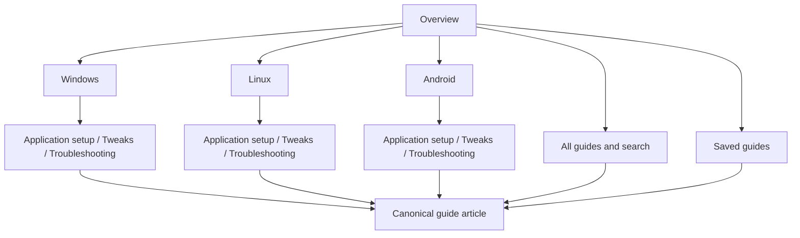

# FIELDNOTES design prototype

Status: implemented from the supplied FIELDNOTES handover specification; direct Figma comparison is **UNVERIFIED** because the Figma connector requires reauthentication.

## Design intent

The visual system is a “midnight emerald aurora” technical field guide: dark, calm, information-dense, and source-forward. Visual polish must never hide risk, compatibility, provenance, focus, or failure states.

## Information architecture

One canonical article may appear in more than one OS/category collection. Breadcrumbs always use its primary placement.

## Tokens and typography

The implementation source of truth is `src/styles/global.css`.

| Role | Token/value |
| --- | --- |
| Primary background | `--fn-bg-primary: #050b09` |
| Secondary background | `--fn-bg-secondary: #0b1711` |
| Surface | `--fn-surface: #10241b` |
| Accent | `--fn-accent: #22c55e` |
| Bright accent/focus | `--fn-accent-bright: #4ade80` |
| Primary text | `--fn-text: #f3fff7` |
| Muted text | `--fn-text-muted: #86a18f` |
| Warning | `--fn-warning: #fbbf24` |
| Danger | `--fn-danger: #fb7185` |
| Display headings | Manrope |
| Body/UI | Inter |
| Source/code | IBM Plex Mono |

Fonts are self-hosted through pinned Fontsource packages; the site does not depend on a third-party font request at runtime.

## Primary components and states

| Component | Default and interaction states | Recovery/failure state |
| --- | --- | --- |
| Global header | Search, saved-guides link, compact mobile search/menu triggers | Search remains a standard form; navigation remains in static HTML |
| Sidebar | Active route, collection links, desktop sticky layout, mobile drawer | Escape/backdrop closure, contained focus loop, focus return, and restored body scroll |
| OS card | Platform icon, mapped count, hover/focus elevation | Counts come from generated coverage rather than hard-coded copy |
| Guide card | Status/risk badges, OS/category placement, summary | Empty collection renders an intentional empty-state panel |
| Directory search | Query URL, full-text results, filters | Clear no-results message; static guide list exists before enhancement |
| Article header | Risk/status/placement badges, bookmark, mode switch, progress | Storage denial leaves content readable and does not block navigation |
| Source document | Collapsible transcription, path, format/pages, exact-copy control | Clipboard denial selects the source text for manual copying |
| Guided steps | Checkboxes and progress stored per reading version | Changed reading version resets completion but preserves bookmark intent |
| Migration exception | Critical notice and annotations | Operational text is absent for `review-only` and `blocked` guides |
| Provenance ledger | Source path, extraction status, SHA-256, Git revision | Untracked user input is labeled instead of assigned a fake revision |

## Responsive behavior

| Viewport class | Intended behavior | Automated reference viewport |
| --- | --- | --- |
| Desktop | Persistent left navigation, wide content, multi-column cards | 1440 × 900 |
| Tablet | Condensed layout with reflowed cards and bounded content | 900 × 1100 |
| Mobile | Drawer navigation, single-column reading, touch-friendly controls, no horizontal page overflow | 390 × 844 |

The CSS minimum width is 320 px. Long source paths, hashes, commands, and table content may scroll inside their own bounded regions; they must not force the page viewport wider.

Six generated captures (homepage and n8n article at all three reference widths) were inspected after the final responsive changes. They provide local overflow/layout evidence only; the approved Figma frames were unavailable for comparison.

## Accessibility contract

- One clear page-level heading with ordered section headings.
- Skip link and semantic `header`, `nav`, `main`, `article`, `section`, table, form, and button elements.
- Visible 3 px `:focus-visible` outline; no colour-only status communication.
- Accessible control names and `aria-pressed` state for bookmarks and reading modes.
- Keyboard-operable navigation, disclosure widgets, copy actions, filters, and guided steps.
- Reduced-motion media query removes meaningful transitions and smooth scrolling.
- Empty, blocked, loading, and failure behavior remains understandable without relying on animation.

The 24-case matrix covers representative axe checks, reduced motion, mobile search, drawer focus containment/return, copy fallback, and keyboard-operable controls. Screen-reader, manual 200% zoom, full contrast, and focus-obscuration acceptance still require manual review.

## Figma parity gate

The implementation must not be described as Figma-perfect until all of these are recorded:

1. Reauthenticate the connected Figma account.
2. Inspect the named FIELDNOTES file and exact frame/node references from the handover.
3. Compare real browser captures at the reference desktop, tablet, and mobile widths.
4. Log differences for typography, spacing, colour, icons, responsive reflow, empty/error states, and interactions.
5. Repair material differences and repeat the comparison.

Current result: **BLOCKED / UNVERIFIED**. The connector returned a reauthentication requirement; no reference frame was silently approximated as verified evidence.
