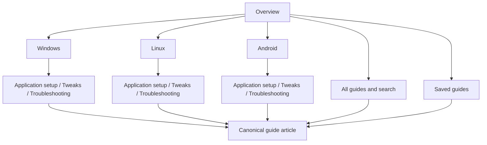

# Technical Resources design prototype

Status: Figma-aligned implementation completed from live design context on 2026-11-20. Named frames were inspected and compared with local browser captures; pixel-perfect human approval, physical-device review, and deployed-site parity remain **UNVERIFIED**.

## Design intent

The visual system is a “midnight emerald aurora” technical field guide: dark, calm, information-dense, and source-forward. Visual polish must never hide risk, compatibility, provenance, focus, or failure states.

## Information architecture

One canonical article may appear in more than one OS/category collection. Breadcrumbs always use its primary placement.

## Tokens and typography

The implementation source of truth is `src/styles/global.css`.

| Role | Token/value |
| --- | --- |
| Primary background | `--fn-bg-primary: #050b09` |
| Secondary background | `--fn-bg-secondary: #0b1711` |
| Surface | `--fn-surface: #10241b` |
| Accent | `--fn-accent: #22c55e` |
| Bright accent/focus | `--fn-accent-bright: #4ade80` |
| Primary text | `--fn-text: #f3fff7` |
| Muted text | `--fn-text-muted: #86a18f` |
| Warning | `--fn-warning: #f3b76a` |
| Danger | `--fn-danger: #fb7185` |
| Display headings | Manrope |
| Body/UI | Inter |
| Source/code | IBM Plex Mono |

Fonts are self-hosted through pinned Fontsource packages; the site does not depend on a third-party font request at runtime.

## Primary components and states

| Component | Default and interaction states | Recovery/failure state |
| --- | --- | --- |
| Global header | `KB` mark, Technical Resources lockup, centred search, GitHub link, tablet/mobile menu | Search remains a standard form; navigation remains in static HTML |
| Sidebar | Explore, platform/category hierarchy, resources, desktop sticky layout, tablet/mobile drawer | Escape/backdrop closure, contained focus loop, focus return, and restored body scroll |
| Mobile bottom navigation | Explore, Search, and Saved destinations at mobile widths | Static links remain usable without client-side state |
| OS card | Platform icon, mapped count, hover/focus elevation | Counts come from generated coverage rather than hard-coded copy |
| Guide card | Status/risk badges, OS/category placement, summary | Empty collection renders an intentional empty-state panel |
| Directory search | Query URL, full-text results, filters | Clear no-results message; static guide list exists before enhancement |
| Article header | Risk/status/placement badges, bookmark, mode switch, progress | Storage denial leaves content readable and does not block navigation |
| Source document | Collapsible transcription, path, format/pages, exact-copy control | Clipboard denial selects the source text for manual copying |
| Guided steps | Checkboxes and progress stored per reading version | Changed reading version resets completion but preserves bookmark intent |
| Migration exception | Critical notice and annotations | Operational text is absent for `review-only` and `blocked` guides |
| Provenance ledger | Source path, extraction status, SHA-256, Git revision | Untracked user input is labeled instead of assigned a fake revision |

## Responsive behavior

| Viewport class | Intended behavior | Automated reference viewport |
| --- | --- | --- |
| Desktop (`>64rem`) | 78 px header, 265 px persistent navigation, wide content, multi-column cards | 1440 × 900 |
| Tablet (`≤64rem`) | 76 px header, drawer navigation, visible header search/Menu, reflowed cards and bounded content | 900 × 1100 |
| Mobile (`≤48rem`) | 77–79 px compact header, drawer navigation, single-column reading, fixed Explore/Search/Saved bar, no horizontal page overflow | 390 × 844 |

The CSS minimum width is 320 px. Long source paths, hashes, commands, and table content may scroll inside their own bounded regions; they must not force the page viewport wider.

Nine generated captures (homepage, Windows collection, and n8n article at desktop, tablet, and mobile widths) were inspected after the responsive changes. Live Figma context was retrieved for file `ERm05Qgx3Ibb1XgXATnHds`: desktop home `15:26`, desktop Windows collection `25:75`, desktop n8n article `16:38`, mobile home `16:158`, tablet home `58:297`, tablet n8n article `59:310`, and mobile Windows collection `28:197`. This is implementation and local-comparison evidence, not a claim of pixel-perfect human approval or physical-device/deployed rendering.

## Accessibility contract

- One clear page-level heading with ordered section headings.
- Skip link and semantic `header`, `nav`, `main`, `article`, `section`, table, form, and button elements.
- Visible 3 px `:focus-visible` outline; no colour-only status communication.
- Accessible control names and `aria-pressed` state for bookmarks and reading modes.
- Keyboard-operable navigation, disclosure widgets, copy actions, filters, and guided steps.
- Reduced-motion media query removes meaningful transitions and smooth scrolling.
- Empty, blocked, loading, and failure behavior remains understandable without relying on animation.

The final 27-case matrix passed across desktop, tablet, and mobile. It covers representative axe checks, reduced motion, responsive shell behavior, collection rows, drawer focus containment/return, copy fallback, and keyboard-operable controls. Screen-reader, manual 200% zoom, full contrast, and focus-obscuration acceptance still require manual review.

## Figma parity gate

The implementation must not be described as Figma-perfect until all of these are recorded:

1. Inspect the named Technical Resources file and exact frame/node references from the handover. **Complete.**
2. Compare real browser captures at the reference desktop, tablet, and mobile widths. **Complete locally for the named home, collection, and article views.**
3. Log and repair material differences in typography, spacing, colour, icons, responsive reflow, empty/error states, and interactions. **Implemented for the inspected frames.**
4. Complete a final human review at exact frame dimensions and representative browser zoom/device settings. **UNVERIFIED.**
5. Repeat the comparison against the deployed Pages artifact. **UNVERIFIED; no deployment was performed.**

Current result: **FIGMA-ALIGNED LOCAL IMPLEMENTATION / FINAL APPROVAL UNVERIFIED**. Live reference evidence is available and no longer blocked; this record intentionally does not use “Figma-perfect.”
